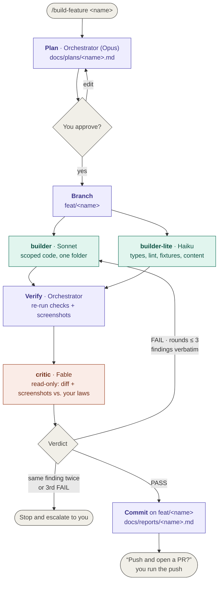
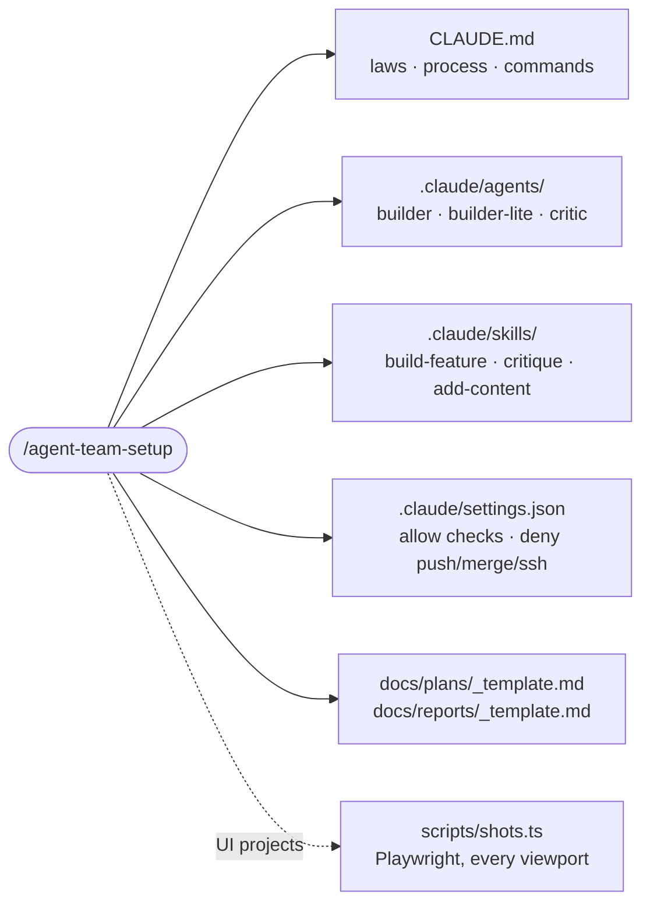

# agent-team-setup

A Claude Code skill that installs a small agent team into any repo and gives you one command to build a feature with it:

- **Opus** plans and orchestrates — and never writes app code.
- **Sonnet** and **Haiku** build — and never judge their own work.
- **Fable** critiques, read-only — it can't edit, so it can't talk itself into a fix.
- **Nothing is pushed** without you. `git push`, merge, rebase and deploy are denied in settings, not just discouraged.

## How a feature gets built



<sub>Purple: orchestrator · Teal: writes code · Coral: judges, never writes · Gray: you</sub>

## The team

| Role | Model | Can write? | Job |
| --- | --- | --- | --- |
| Orchestrator | `opus` (your main session) | plans, reports, commits only | plan, delegate, verify, loop, hand off |
| `builder` | `sonnet` | yes, inside its assigned folder | one scoped piece of code |
| `builder-lite` | `haiku` | yes, mechanical only | types, lint, fixtures, content files |
| `critic` | `fable` | **no** — Read, Glob, Grep, Bash | `VERDICT: PASS` or a numbered fix list tagged by law |

The critic judges against **your laws**: three to six numbered, checkable rules in `CLAUDE.md` (e.g. "Law 2 — Show, don't write: a project highlight is one line"). Findings come back as `[LAW2] hero.tsx:14 — 41-word intro — cut to the first clause`, so every fix is specific and traceable.

## What gets installed in your repo



| Sub-skill | When | What it does |
| --- | --- | --- |
| `/build-feature <name>` | every feature | the full loop above |
| `/critique [branch]` | before a PR, after hand edits | runs the critic alone and prints the verdict; changes nothing |
| `/add-content <url \| path \| title>` | routine updates | adds one schema-valid content file (post, project, docs page) with one critic round |

## Install the skill

**As a plugin** (Claude Code):

```
/plugin marketplace add cheesecake70/agent-team-setup
/plugin install agent-team-setup@agent-team-setup
```

**Or copy it** into your personal skills:

```bash
git clone https://github.com/cheesecake70/agent-team-setup
cp -r agent-team-setup/skills/agent-team-setup ~/.claude/skills/
```

## Use it

```bash
cd your-repo
claude --model opus
```

1. `/agent-team-setup` — it reads your repo, then asks once for your laws, spec path, check/dev/build/screenshot commands and viewports. It writes the files above and merges with anything you already have.
2. `/build-feature <name>` — plan → approve → build → critic loop → commit → it asks before pushing.
3. `/critique` or `/add-content` whenever you need them.

Change any agent's model in its frontmatter (`.claude/agents/*.md`).

## Repo layout

```
.claude-plugin/            plugin + marketplace manifests
skills/agent-team-setup/
├── SKILL.md               the installer
└── templates/
    ├── CLAUDE.md
    ├── settings.json
    ├── agents/            builder.md · builder-lite.md · critic.md
    ├── skills/            build-feature/ · critique/ · add-content/
    ├── scripts/shots.ts
    └── docs/              plans/_template.md · reports/_template.md
```

Templates use `{{PLACEHOLDERS}}` (`OWNER`, `CHECK_CMD`, `SHOTS_CMD`, `VIEWPORTS`, …) that the installer fills, and `<!-- ui-only -->` blocks it strips for projects without screens.

## Rules the team never breaks

- The orchestrator never writes application code.
- Nobody relaxes a critic finding to get a PASS.
- Max 3 critic rounds; the same finding twice means the spec is ambiguous, and you decide.
- One feature, one branch, one commit, one question at the end.
- Never push, merge, rebase or deploy without you.

Inspired by a portfolio build where the two laws were *"they always know where to look"* and *"show, don't write"*.
