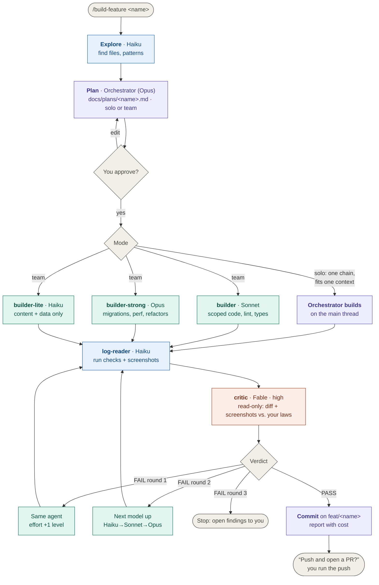
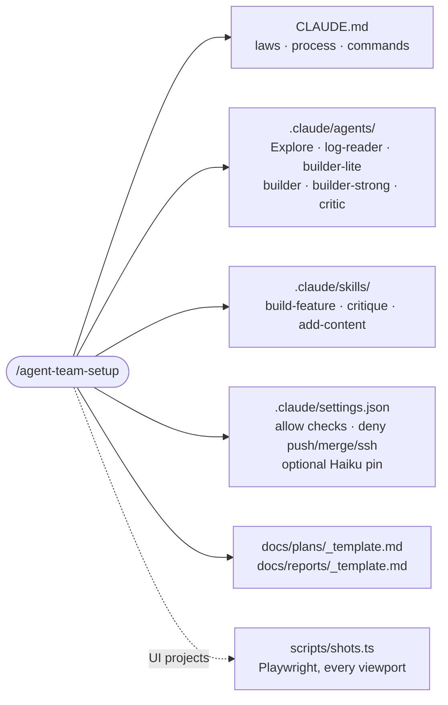

# agent-team-setup

A Claude Code skill that installs a small agent team into any repo and gives you one command to build a feature with it:

- **Opus** plans and orchestrates. It builds small features itself and delegates big ones.
- **Sonnet** and **Opus** builders write the code, each sized to the job. **Haiku** searches, reads logs and writes content, but never touches source code.
- **Fable** critiques read-only. It can't edit, so it can't talk itself into a fix.
- When the critic fails the work, the loop **raises effort first, then the model**, and stops after three rounds.
- **Nothing is pushed** without you. `git push`, merge, rebase and PR creation are denied in settings, not just discouraged.

The model choices follow Anthropic's [Which Claude model should you build with?](https://claude.dev/blog/which-claude-model-should-you-build-with/)

## How a feature gets built



<sub>Purple: orchestrator · Blue: reads only (Haiku) · Teal: writes · Coral: judges, never writes · Gray: you</sub>

## The team

| Agent | Model · effort | Writes | Job |
| --- | --- | --- | --- |
| Orchestrator | `opus` (your session); `fable` for architecture-heavy work | plans, reports, commits; code in solo mode | plan, pick solo or team, delegate, loop, hand off |
| `Explore` | `haiku` · low | nothing | find files, call sites and patterns; summarise READMEs |
| `log-reader` | `haiku` · low | nothing | run checks and screenshots, report each failure in one line |
| `builder-lite` | `haiku` · low | content and data files only | posts, frontmatter, JSON entries, fixture data |
| `builder` | `sonnet` · medium | source code, one folder | scoped features, bug fixes, type and lint fixes |
| `builder-strong` | `opus` · medium | source code, several folders | migrations, performance work, major refactors, escalations |
| `critic` | `fable` · high | **nothing** — Read, Glob, Grep, Bash | `VERDICT: PASS` or a numbered fix list tagged by law |

Why each choice:

- **Opus 5.5 is the default** for complex work; Fable 5.2 is for architecture and for leading many sub-agents.
- **Sonnet 5.5 for spec-driven code.** A clear spec doesn't make migrations or performance work easy, though, so those go to Opus.
- **Haiku 5.5 reads, it doesn't edit code.** A misread search result sends the main model to the wrong file. Haiku searches, reads logs and writes schema-checked content.
- **Effort before model.** On a FAIL the loop raises effort one level first. Past `high`, the next model up at a lower effort usually costs about the same or less.
- **Solo for small work.** If a feature is one chain of steps that fits one context, splitting it costs more than it saves, so the orchestrator builds it itself. The critic still judges.
- **Fable as critic.** Fable 5.2 at `high` roughly matches Opus 5.5 at `max` for about half the cost per task, so it suits short, judgement-heavy runs. Every report records cost; if the Fable critic doesn't pay for itself on your work, change one line to `model: opus`.

The critic judges against **your laws**: three to six numbered, checkable rules in `CLAUDE.md` (e.g. "Law 2 — Show, don't write: a project highlight is one line"). Findings come back as `[LAW2] hero.tsx:14 — 41-word intro — cut to the first clause`, so every fix is specific and traceable.

### Which model version?

The agents use aliases (`haiku`, `sonnet`, `opus`, `fable`), which follow the newest model in each family: **Haiku, Sonnet and Opus 5.5, and Fable 5.2**. Version numbers don't line up across families, and Fable 5.1 is the previous generation; there's no reason to use it.

On the Anthropic API, `haiku` needs Claude Code v2.1.293 or later. On Amazon Bedrock, Google Cloud, Microsoft Foundry and Claude Platform on AWS, `haiku` still means Haiku 4.5; the installer offers to pin Haiku 5.5 with `ANTHROPIC_DEFAULT_HAIKU_MODEL`. Run `/model` once to confirm what each alias resolves to on your setup.

## What gets installed in your repo



| Sub-skill | When | What it does |
| --- | --- | --- |
| `/build-feature <name>` | every feature | the full loop above |
| `/critique [branch]` | before a PR, after hand edits | runs the critic alone and prints the verdict; changes nothing |
| `/add-content <url \| path \| title>` | routine updates | adds one schema-valid content file (post, project, docs page) with one critic round |

## Install the skill

**As a plugin** (Claude Code):

```
/plugin marketplace add cheesecake70/agent-team-setup
/plugin install agent-team-setup@agent-team-setup
```

**Or copy it** into your personal skills:

```bash
git clone https://github.com/cheesecake70/agent-team-setup
cp -r agent-team-setup/skills/agent-team-setup ~/.claude/skills/
```

## Use it

```bash
cd your-repo
claude --model opus     # or --model fable for architecture-heavy work
```

1. `/agent-team-setup` reads your repo, then asks once for your laws, spec path, commands, viewports and platform. It writes the files above and merges with anything you already have.
2. `/build-feature <name>`: plan → approve → solo or team build → critic loop → commit → it asks before pushing.
3. Use `/critique` or `/add-content` whenever you need them.

Change any agent's model or effort in its frontmatter (`.claude/agents/*.md`).

## Repo layout

```
.claude-plugin/            plugin + marketplace manifests
skills/agent-team-setup/
├── SKILL.md               the installer
└── templates/
    ├── CLAUDE.md
    ├── settings.json
    ├── agents/            explore · log-reader · builder-lite · builder · builder-strong · critic
    ├── skills/            build-feature/ · critique/ · add-content/
    ├── scripts/shots.ts
    └── docs/              plans/_template.md · reports/_template.md
```

Templates use `{{PLACEHOLDERS}}` (`OWNER`, `CHECK_CMD`, `SHOTS_CMD`, `VIEWPORTS`, …) that the installer fills, and `<!-- ui-only -->` blocks it strips for projects without screens.

## Rules the team never breaks

- In team mode, the orchestrator never writes application code.
- Haiku agents never edit source code.
- Nobody relaxes a critic finding to get a PASS.
- Max 3 critic rounds: effort up, then model up, then stop. A finding that survives the model step-up means the spec is ambiguous, and you decide.
- One feature, one branch, one commit, one question at the end.
- Never push, merge, rebase or deploy without you.

Inspired by a portfolio build where the two laws were *"they always know where to look"* and *"show, don't write"*.
